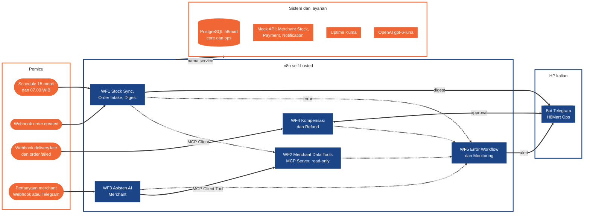

# Milestone 3 · H8Mart Quick-Commerce Ops

Dikerjakan **individu**. Dinilai dengan **rubric penilaian** (7 bagian, total 100; poin di [bagian 6](#6-penilaian)). Tidak ada presentasi: nilai berasal dari isi repo dan smoke test ke Production URL.

> **Mulai di sini**
>
> 1. Buat repo **public** di akun GitHub kalian dari isi folder `set_1` ([bagian 5](#5-yang-dikumpulkan)), kirim link-nya ke instruktur lewat DM, lalu ikuti [SETUP.md](SETUP.md) sampai stack hidup dan data terbaca.
> 2. Buat bot Telegram kalian ([SETUP.md bagian 5b](SETUP.md#5b-bot-telegram-h8mart-ops)) dan kirim satu pesan uji.
> 3. Baca daftar tugas kalian di [guide/tasks.md](guide/tasks.md). Bangun **WF5 lebih awal** dan **WF2 sebelum WF3**. Langkah per tahap ada di **Peta Kerja** ([bagian 4](#4-jadwal-weekday-phase-3)).
> 4. Simpan hasil sejak hari pertama ke `workflows/`, `docs/`, dan `evidence/`, lalu commit rutin.

## 1. Skenario

**H8Mart** (dibaca "Hacktiv8 Mart", fiktif) adalah aplikasi quick-commerce: belanja kebutuhan harian dari minimarket dan toko mitra di Jabodetabek, diantar kurir mitra dalam ±30 menit. H8Mart **tidak punya gudang sendiri**; stok ada di merchant, jadi kebenaran stok bergantung pada sinkronisasi dari sistem merchant. Dua belas merchant di tiga zona (Jakarta Selatan, Tangerang, Bekasi) sudah terhubung.

Tim Ops kewalahan karena lima hal:

1. **Stok tidak sinkron.** Sinkronisasi dari Merchant Stock API sering terlambat atau gagal diam-diam, sehingga pelanggan memesan barang yang ternyata habis.
2. **SLA 30 menit terlewat.** Kompensasi voucher diberikan manual lewat spreadsheet.
3. **Refund order gagal** diproses manual oleh tim finance, kadang dua kali.
4. **Merchant bertanya ke CS** ("kenapa order saya banyak batal kemarin?") dan CS menarik data manual. H8Mart ingin **asisten AI merchant**.
5. **Tidak ada yang tahu kalau laporan harian atau sinkronisasi stok berhenti.**

Tugas kalian: membangun **lima workflow n8n** yang menutup masalah itu, men-deploy-nya di instance self-hosted, dan mendokumentasikannya seperti proposal ke bisnis. Sistem kalian berbicara lewat **bot Telegram H8Mart Ops di HP kalian**. Semua bahan (database, API tiruan, event, dataset uji) sudah disediakan; kalian tidak perlu mengerjakan Milestone 1 atau 2.

### Hasil akhir yang harus bisa ditunjukkan

1. **Order masuk** lewat Production URL: diterima bila stok cukup, ditolak (409) bila stok habis (WF1).
2. **Stok tersinkron** tiap 15 menit tanpa duplikat; merchant yang gagal permanen masuk dead-letter, merchant lain tetap jalan (WF1).
3. **Digest pagi 07.00** masuk ke bot Telegram kalian (WF1).
4. **Merchant bertanya**, asisten AI menjawab dari data lewat tool MCP, atau eskalasi ke CS bila ragu (WF3 + WF2).
5. **Pengantaran telat** dapat voucher otomatis; **refund besar** menunggu approval Ops (tombol Telegram, atau Wait node selama lokal) dan dibayar tepat sekali (WF4).
6. **Kegagalan terlihat:** alert Telegram dengan business key, kegagalan diam-diam dan perlambatan terdeteksi, heartbeat Uptime Kuma Up dan Down (WF5).
7. **Semua berjalan di VPS HTTPS** dan terdokumentasi dalam lima dokumen seperti proposal ke bisnis.

## 2. Hasil Belajar

Setelah menyelesaikan Milestone, kalian dapat:

1. Memetakan proses manual (as-is) menjadi alur automasi (to-be) dengan titik manusia dan titik AI, memilih pendekatan rule-based, AI, atau manusia untuk tiap keputusan, dan memperkirakan ROI-nya.
2. Membangun workflow n8n end-to-end dengan trigger waktu (Schedule) dan event (Webhook), menggabungkan data dari beberapa sumber (Merge), serta memakai If/Switch dan Code node.
3. Mengintegrasikan API, webhook, dan database eksternal secara idempotent dengan credential yang aman.
4. Mengekspos tool read-only lewat MCP Server, memakainya dari MCP Client dan agent, serta menambahkan reasoning AI dengan output terstruktur, guardrail, dan fallback.
5. Menerapkan retry, dead-letter, alerting, dan Error Workflow dengan bukti eksekusi, serta memantau kegagalan diam-diam dan perlambatan.
6. Men-deploy n8n self-hosted dengan HTTPS, membandingkan biaya (TCO), dan menilai kesiapan governance sebelum production.

## 3. Sistem yang Harus Dibangun

### Peta arsitektur



Diagram menunjukkan **susunan**, bukan konfigurasi. Syarat rinci tiap workflow ada di [guide/](guide/README.md).

### Struktur folder

Isi folder `set_1` menjadi isi repo kalian. Yang kalian isi hanya **tiga folder** (`workflows/`, `docs/`, `evidence/`); sisanya disediakan dan tidak diubah (kecuali `.env` lokal yang tidak di-commit). `.gitkeep` boleh dihapus setelah folder terisi.

```text
h8mart-ops/
│   # disediakan, tidak diubah
├── README.md          soal ini
├── SETUP.md           menjalankan stack di laptop dan VPS, membuat bot Telegram
├── data-contract.md   skema database, payload event, kontrak API
├── guide/             tugas per bagian penilaian, syarat tiap workflow, Telegram, pengumpulan
├── compose.yaml       stack lokal: n8n 2.44.7 + task runners, PostgreSQL, mock API, Uptime Kuma
├── compose.vps.yaml   tambahan untuk VPS (Caddy HTTPS), dipakai bersama compose.yaml
├── Caddyfile
├── .env.example       salin menjadi .env (tidak di-commit)
├── seed/              data sintetis 90 hari (12 merchant), role mcp_reader dan ops_writer
├── mock-api/          Merchant Stock, Payment, dan Notification API tiruan
├── fixtures/          event contoh dan dev set 10 kasus untuk asisten AI
├── assets/            gambar contoh canvas
│
│   # kalian isi
├── workflows/         export JSON WF1-WF5
├── docs/              lima dokumen kerangka (01-05), lengkapi
└── evidence/          bukti uji per workflow dan bukti deploy
    ├── wf1/ … wf5/
    └── deploy/
```

| Folder | Yang kalian isi | Mulai |
| --- | --- | --- |
| `workflows/` | Export JSON terbaru, nama `wf1-<nama>.json` … `wf5-<nama>.json`; credential ID dan token push Kuma diganti placeholder ([petunjuk](workflows/README.md)) | W2D1 |
| `docs/` | Lengkapi lima dokumen kerangka (nama file tetap) | TCO sejak S08; BRD, desain + ROI, readiness dari lab S13-S15; README solusi setelah workflow selesai |
| `evidence/` | Bukti bernomor per workflow ([petunjuk](evidence/README.md)) | saat workflow itu jalan; `deploy/` setelah VPS hidup |

### Bot Telegram

Tiap peserta membuat **satu bot** lewat @BotFather (gratis; langkah di [SETUP.md bagian 5b](SETUP.md#5b-bot-telegram-h8mart-ops)). Bot dipakai di **empat touchpoint**: digest pagi (WF1), alert (WF5), tombol approval refund (WF4), dan chat asisten merchant (WF3, nilai penuh). Token bot tidak pernah masuk repo, `.env`, atau export. Tombol approval dan chat asisten butuh VPS HTTPS; aturan lengkapnya di [guide/telegram-bot.md](guide/telegram-bot.md).

### Data dan uji mandiri

- Skema, payload event, dan kontrak API: [data-contract.md](data-contract.md).
- **Hari data terakhir:** semua "kemarin" dan "hari ini" di soal, digest, tool MCP, dan pertanyaan merchant merujuk ke tanggal di `core.data_info` (`SELECT hari_data_terakhir FROM core.data_info`), bukan jam sistem, jadi angkanya sama di setiap laptop dan VPS. Order live dari webhook tetap memakai tanggal sebenarnya. Rincian: [data-contract.md](data-contract.md) bagian 2.
- **Uji mandiri:** kirim event dari `fixtures/` ke webhook kalian. [fixtures/README.md](fixtures/README.md) memuat 28 Kasus Uji Publik dengan hasil yang diharapkan; tidak wajib dikumpulkan. Angka target ambil dari database dan hasil eksekusi sendiri.
- **Kasus tersembunyi:** penilai juga menjalankan kasus yang tidak ada di fixtures lewat Production URL, jadi jangan menyesuaikan workflow hanya agar lolos fixture. Bila API atau model tidak tersedia, workflow harus gagal secara terkendali (alert atau eskalasi) dan tidak mengembalikan hasil rekaan.
- Macet? Lihat [guide/common-mistakes.md](guide/common-mistakes.md).
- **Eksplorasi opsional (tidak dinilai, tanpa poin):** WhatsApp (butuh akun WhatsApp Business dan verifikasi Meta, tidak disediakan di kelas) dan ElevenLabs (voice note di WF3 lewat HTTP Request; node komunitas belum terbukti di n8n 2.44.7). Kontrak jawaban teks WF3 tetap sama.

## 4. Jadwal (Week/Day Phase 3)

Brief dirilis di W2D1, saat materi baru sampai Sesi 6, jadi tiap workflow dikerjakan **setelah sesi pendukungnya**. Tiap tahap diumumkan di #p3-milestone. Kerjakan **Minimum** dulu, tambahkan **Nilai penuh** bila ada waktu.

### Peta Kerja

**1. Kick-off · W2D1, mulai setelah brief**

- [ ] Langkah **Mulai di sini** selesai (repo public, `SETUP.md`, bot Telegram)
- [ ] [WF5](guide/wf5-reliability-monitoring.md): Error Workflow, alert ke Telegram, dead-letter
- [ ] [WF2](guide/wf2-merchant-data-tools.md): tiga tool read-only; kerangka [WF1](guide/wf1-stock-sync-order-intake.md) (Schedule 15 menit, Merge, webhook order dengan If/Switch stok)

Sesi pendukung: S02-S06 (W1D2-W2D1). WF2: konsep MCP di S04, parameter tool `$fromAI` baru di S11, jadi pelajari mandiri dari docs [MCP Server Trigger](https://docs.n8n.io/integrations/builtin/core-nodes/n8n-nodes-langchain.mcptrigger/), [node Postgres sebagai tool](https://docs.n8n.io/integrations/builtin/app-nodes/n8n-nodes-base.postgres/), dan [`$fromAI()`](https://docs.n8n.io/build/integrate-ai/ai-examples/use-ai-for-parameters). Telegram: [node Telegram](https://docs.n8n.io/integrations/builtin/app-nodes/n8n-nodes-base.telegram/) dan [Telegram Trigger](https://docs.n8n.io/integrations/builtin/trigger-nodes/n8n-nodes-base.telegramtrigger/).

**2. Foundation · target W2D3**

- [ ] WF1: sinkron 15 menit dengan Retry On Fail + upsert idempotent; digest 07.00 ke Telegram
- [ ] [WF4](guide/wf4-compensation-refund.md): voucher otomatis dan refund otomatis di bawah ambang; Payment API dengan header `Idempotency-Key` sejak panggilan pertama ([data-contract.md](data-contract.md) bagian 4)

Sesi pendukung: S07 (W2D2).

**3. Deploy · target W2D5**

- [ ] **Satu VPS** HTTPS setelah lab S09 (`SETUP.md` bagian 7; jangan menunggu W4), dibiarkan hidup sampai instruktur memberi tahu penilaian selesai
- [ ] Heartbeat Uptime Kuma; satu deteksi kegagalan diam-diam; satu alert ambang durasi

Sesi pendukung: S08-S10 (W2D3-W2D5).

**4. AI & Approval · target W3D3**

- [ ] [WF3](guide/wf3-ai-merchant-assistant.md): agent, output terstruktur, guardrail, fallback, lewat Webhook production
- [ ] WF4: approval Ops lewat tombol Telegram di VPS HTTPS, atau Wait node

Sesi pendukung: S11 (W3D1), S12 (W3D2). Approval belum dibahas di sesi, jadi pelajari mandiri dari docs [Send and Wait for Response](https://docs.n8n.io/integrations/builtin/app-nodes/n8n-nodes-base.telegram/message-operations/#send-and-wait-for-response) dan [Wait](https://docs.n8n.io/integrations/builtin/core-nodes/n8n-nodes-base.wait/).

**5. Checkpoint · W3D5 23.59, target selesai**

- [ ] Semua Minimum selesai dan di-push: WF1-WF5, lima dokumen (BRD + process map, desain + ROI, readiness dari lab S13-S15; TCO sudah dimulai sejak S08), dan evidence
- [ ] DM info akses penilai terkirim

Sesi pendukung: S13-S15 (W3D3-W3D5). Selesai di W3D5 berarti nilai keluar lebih cepat dan W4D1-W4D5 bebas untuk Capstone Project.

**6. Submission · maksimal W4D4 23.59**

- [ ] Yang belum selesai di W3D5 diselesaikan di W4D1-W4D4: VPS hidup dan tidak di-terminate (paling lambat W4D2), kelima workflow Published, evidence `wf1` sampai `wf5` dan `deploy` bernomor, lima dokumen final (TCO tiga opsi berumus dengan tanggal dan sumber harga)
- [ ] Push terakhir ke `main` dan DM info akses penilai sebelum 23.59

Mentoring Milestone tetap ada di W4D1-W4D4 (bersama mentoring Capstone Project). Nilai keluar paling lambat **sebelum kelas W4D5 19.00**; kelas W4D5 dipakai presentasi Capstone Project (Milestone tidak dipresentasikan). Kerjakan dokumen sambil mengikuti materi W3; jangan menunggu minggu terakhir.

## 5. Yang Dikumpulkan

Pengumpulan = **repo GitHub public di akun kalian sendiri**, satu repo per peserta; tanpa Pull Request. Repo public bisa dibaca siapa saja, jadi **jangan commit secret**; token penilaian hanya dikirim lewat DM.

1. **Buat repo public kosong** (mis. `h8mart-ops`) di akun GitHub kalian (tanpa README, `.gitignore`, atau lisensi), salin **isi** folder `set_1` hasil clone repo materi ke dalamnya (termasuk file tersembunyi seperti `.gitignore`), lalu push ke `main`. Kerja langsung di `main`; commit dan push rutin.
2. **Kirim link repo ke instruktur lewat DM** (`Milestone P3 · <Nama> · <link repo>`) begitu repo dibuat.
3. **Begitu selesai, kirim DM info akses penilai** (URL VPS, path webhook, token penilaian; bukan di repo atau channel). Milestone **dinilai begitu selesai**; disarankan selesai di **W3D5 23.59** supaya cepat dinilai dan tidak mengganggu Capstone Project di W4D1-W4D5. Setelah DM terkirim, jangan push lagi kecuali instruktur memintanya.
4. **Maksimal W4D4 23.59 WIB:** yang dinilai adalah isi repo pada push terakhir ke `main`, dihitung dari **waktu push yang tercatat di GitHub** (bukan timestamp commit lokal).

README solusi (`docs/05-readme-solusi.md`) harus cukup bagi penilai untuk menjalankan dan memverifikasi tanpa bertanya. Rincian lain ada di [guide/submission.md](guide/submission.md): bukti (Evidence) per folder, cegah banjir alert dan digest, hal yang tidak boleh dikumpulkan, checklist sebelum push terakhir, dan format DM.

## 6. Penilaian

Rubric penilaian: 7 bagian, total 100. Tugas lengkap per bagian ada di [guide/tasks.md](guide/tasks.md), bukti yang diminta di [guide/submission.md](guide/submission.md#evidence).

| Bagian | Poin | Yang dilihat |
| --- | ---: | --- |
| [Business Requirement & Solution Design](guide/tasks.md#business-requirement--solution-design) | 15 | BRD dan process map as-is/to-be, keputusan rule-based vs AI vs manusia, estimasi ROI |
| [n8n Workflow Build](guide/tasks.md#n8n-workflow-build) | 20 | Trigger dan node yang tepat, data digabung dan diproses (Merge, If/Switch, Code), jadwal dan event |
| [System Integration & MCP](guide/tasks.md#system-integration--mcp) | 15 | Koneksi ke API, webhook, database, dan Telegram; MCP server dan agent tools |
| [AI on Automation](guide/tasks.md#ai-on-automation) | 10 | Asisten WF3: output di-parse, fallback, guardrail eskalasi |
| [Reliability & Monitoring](guide/tasks.md#reliability--monitoring) | 15 | Retry, dead-letter, alert, Error Workflow; heartbeat Kuma, deteksi gagal diam-diam, alert perlambatan |
| [Deployment, Cost & Governance](guide/tasks.md#deployment-cost--governance) | 15 | n8n berjalan di VPS dengan HTTPS, perbandingan biaya, credential dan akses aman, readiness checklist |
| [Workflow Quality & Documentation](guide/tasks.md#workflow-quality--documentation) | 10 | Berjalan end-to-end, nama node jelas, sticky note, README solusi |

Secret asli di repo, export, atau screenshot dan instance yang tidak berjalan saat dinilai sama-sama menurunkan nilai bagian Deployment, Cost & Governance.

Kumpulkan versi yang berjalan sebelum menyempurnakan. Bagian paling berisiko: **Deployment**. Bila instance kalian bermasalah, buat ulang dengan `SETUP.md` bagian Deploy ke VPS; menjalankan lokal dengan bukti (Plan B) tetap diterima, tetapi nilai Deployment berkurang.
