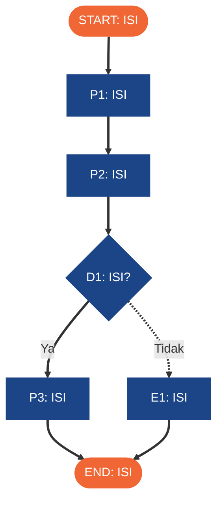
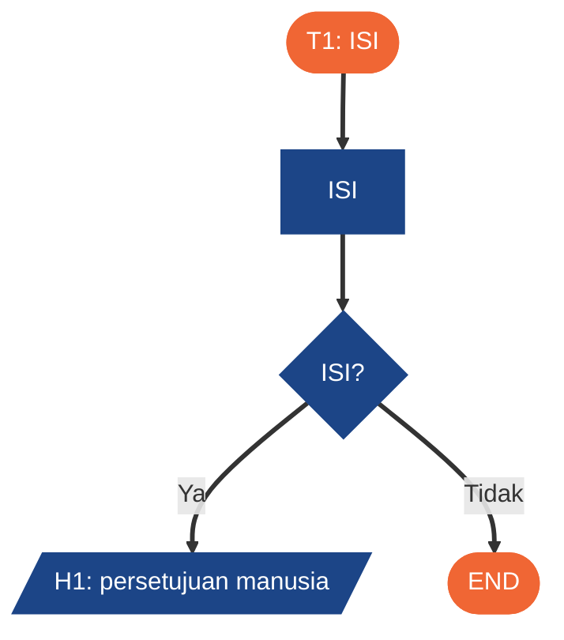

# 01 · BRD Ringkas + Process Map As-Is / To-Be · H8Mart Quick-Commerce Ops

**Nama:**

> Template dokumen Milestone (target selesai W3D5 23.59, maksimal W4D4 23.59). Isi langsung berkas ini (`docs/01-brd-process-map.md`), lalu hapus baris petunjuk yang diawali `>`.
> Strukturnya sama dengan Lab Sesi 13 (BRD ringkas + process map + tabel translasi). Bahan wawancara: bagian 1 *Skenario* di README milestone.

## 1. BRD Ringkas

> Kolom Sumber berisi potongan cerita bisnis atau data yang mendasari baris itu. Bila tidak ada sumbernya, tulis "asumsi" dan taruh di bagian 6.

| Item | Isi | Sumber |
| --- | --- | --- |
| Masalah bisnis (minimal 3, mencakup stok, SLA atau refund, dan reliability) | | |
| Tujuan & ukuran keberhasilan (angka) | | |
| Stakeholder & actor | | |
| Volume & frekuensi | | |
| Aturan bisnis BR1 | | |
| Aturan bisnis BR2 | | |
| Aturan bisnis BR3 | | |
| Dalam scope automasi | | |
| Di luar scope (saat ini) | | |

## 2. Process Map As-Is (proses manual hari ini)

> Gambarkan proses yang berjalan **sekarang**: siapa menunggu siapa, di mana jeda terjadi. Ganti setiap `ISI`. Minimal empat process step, dua decision point berlabel, satu jalur exception.

## 3. Process Map To-Be (rancangan automasi)

> Tandai titik yang diautomasi, titik yang tetap manusia (approval Ops), dan titik AI. Kode node di sini dipakai lagi di tabel translasi (bagian 4); kolom *Nama node / workflow* di tabel itu harus sama dengan nama node di export, tetapi kode tidak wajib muncul di nama node. Titik keputusan bisnis memakai kode yang sama dengan tabel keputusan di dokumen 02 (D1-D5).

## 4. Tabel Translasi ke Automation Flow

| Kode | Langkah manual (as-is) | Elemen automation flow (n8n) | Nama node / workflow | Alasan (bukan sekadar mengulang nama node) |
| --- | --- | --- | --- | --- |
| | | | | |

## 5. Langkah yang Sengaja Tidak Diautomasi

| Langkah | Kenapa tetap manusia | Bentuknya di workflow |
| --- | --- | --- |
| | | |

## 6. Asumsi & pertanyaan terbuka

-
