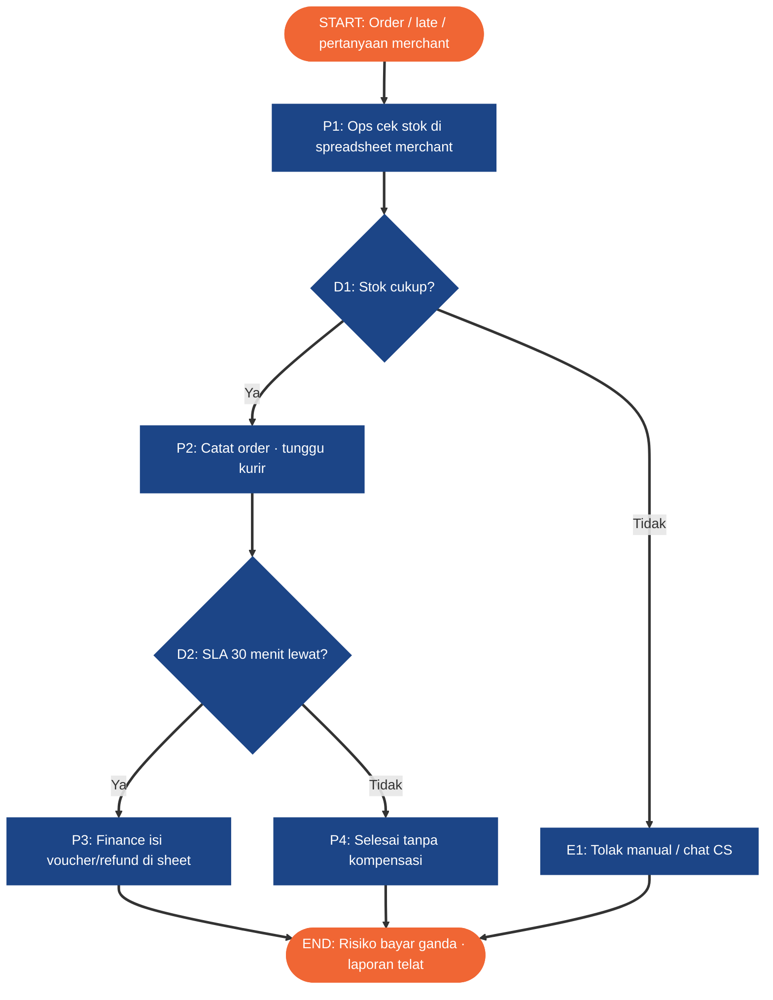
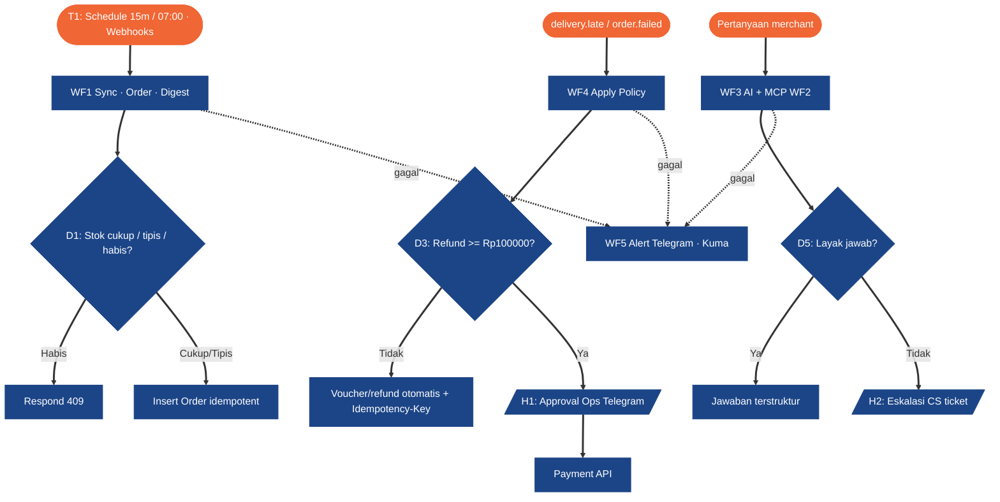

# 01 · BRD Ringkas + Process Map As-Is / To-Be · H8Mart Quick-Commerce Ops

**Nama:** Hani Alfiyyah

## 1. BRD Ringkas

| Item                                                                        | Isi                                                                                                                                                                                                                                                                                                  | Sumber                                                |
| --------------------------------------------------------------------------- | ---------------------------------------------------------------------------------------------------------------------------------------------------------------------------------------------------------------------------------------------------------------------------------------------------- | ----------------------------------------------------- |
| Masalah bisnis (minimal 3, mencakup stok, SLA atau refund, dan reliability) | (1) Sinkron stok merchant sering terlambat/gagal diam-diam → order ke barang yang habis. (2) SLA 30 menit terlewat; voucher & refund besar diproses manual di spreadsheet (risiko bayar dua kali). (3) Merchant bertanya ke CS dan data ditarik manual; gagal sync/digest sering tidak terlihat Ops. | README skenario H8Mart (lima masalah Ops)             |
| Tujuan & ukuran keberhasilan (angka)                                        | Sync tiap ≤15 menit dengan `merchant_stock` stabil ~205 baris; order stok habis → HTTP 409; digest 07.00 WIB ke Telegram; refund ≥ Rp100.000 hanya setelah approval Ops; alert Telegram + heartbeat Uptime Kuma saat gagal.                                                                          | README _Hasil akhir_; kebijakan di WF4 `Apply Policy` |
| Stakeholder & actor                                                         | Ops H8Mart, CS, Finance/Refund, 12 merchant mitra, platform (webhook order/delivery), penilai (smoke Production URL)                                                                                                                                                                                 | README skenario; guide/submission                     |
| Volume & frekuensi                                                          | 12 merchant · 3 zona; sync tiap 15 menit; digest 1×/hari; event order/late/failed burst; data sintetis ~90 hari                                                                                                                                                                                      | seed; Schedule WF1                                    |
| Aturan bisnis BR1                                                           | Order diterima hanya jika stok cukup; habis → 409; stok tipis (tersedia ≤10 dan cukup qty) → 200 `accepted_low_stock`                                                                                                                                                                                | guide WF1; node `Routing Stock Switch`                |
| Aturan bisnis BR2                                                           | `delivery.late`: voucher otomatis Rp10.000 (&lt;20 menit late) / Rp25.000 (≥20 menit). `order.failed` dengan payment captured: refund = `total_amount`; ≥ Rp100.000 → approval Ops Telegram; Decline → Payment tidak dipanggil                                                                       | WF4 `Apply Policy`                                    |
| Aturan bisnis BR3                                                           | Asisten merchant menjawab dari data MCP; ragu/injeksi → eskalasi CS (`ops.tickets`); chat Telegram hanya allowlist `chat_id`→`merchant_id`                                                                                                                                                           | guide WF2/WF3; WF3b                                   |
| Dalam scope automasi                                                        | WF1 sync+order+digest; WF2 MCP; WF3/WF3b asisten; WF4 kompensasi/refund; WF5 error+monitoring; deploy VPS HTTPS                                                                                                                                                                                      | guide/tasks.md                                        |
| Di luar scope (saat ini)                                                    | WhatsApp Business, ElevenLabs voice, stock decrement live sebagai jalur grading Path B, terminate VPS sebelum nilai keluar                                                                                                                                                                           | README eksplorasi opsional; submission                |

## 2. Process Map As-Is (proses manual hari ini)

## 3. Process Map To-Be (rancangan automasi)

## 4. Tabel Translasi ke Automation Flow

| Kode  | Langkah manual (as-is)          | Elemen automation flow (n8n)                | Nama node / workflow                                                                                     | Alasan                                                                       |
| ----- | ------------------------------- | ------------------------------------------- | -------------------------------------------------------------------------------------------------------- | ---------------------------------------------------------------------------- |
| A1    | Pull stok merchant satu-satu    | Schedule + HTTP + Loop + upsert             | WF1 `Schedule Sync 15m` → `Fetch Merchant Stock API` → `Upsert Stock`                                    | Interval tetap; Retry On Fail agar 1 merchant gagal tidak menghentikan semua |
| A2    | Catat merchant API mati di chat | Dead-letter + Telegram (+ Notification API) | WF1 `Dead Letter Merchant` · `Alert Merchant Failed`                                                     | Bukti di `ops.dead_letter` + alert dengan business key                       |
| B1    | Cek stok sebelum terima order   | Webhook + SQL + Switch                      | WF1 `Webhook order.created` → `Check Stock` → `Routing Stock Switch`                                     | Keputusan deterministik dari DB hasil sync                                   |
| C1    | Susun laporan pagi              | Schedule + SQL + MCP + Telegram             | WF1 `Schedule Digest 07:00` → `Compute Daily KPI` → `MCP Client Cancel Reasons` → `Send Digest Telegram` | Satu digest WIB; top cancel reasons dari tool read-only                      |
| D3    | Finance putuskan refund besar   | Send and Wait Telegram                      | WF4 approval path · `Approved?`                                                                          | Uang keluar butuh manusia; voucher/refund kecil tetap rule-based             |
| D4–D5 | CS query DB untuk merchant      | AI Agent + MCP + guardrail                  | WF3 + WF2; WF3b Telegram allowlist                                                                       | AI untuk bahasa alami; angka dari tool; eskalasi bila ragu                   |
| R1    | Tidak tahu sync mati            | Error Workflow + Kuma + silent-fail         | WF5; WF1 `Heartbeat Uptime Kuma` · `Fail Sync 0 Rows`                                                    | Observability tanpa login n8n tiap jam                                       |

## 5. Langkah yang Sengaja Tidak Diautomasi

| Langkah                                         | Kenapa tetap manusia               | Bentuknya di workflow                                           |
| ----------------------------------------------- | ---------------------------------- | --------------------------------------------------------------- |
| Approve/decline refund ≥ Rp100.000              | Risiko finansial & fraud           | WF4 Telegram Send and Wait (Approve Within Chat + Show Outcome) |
| Handle eskalasi CS                              | Butuh judgment & akses sistem luar | WF3 insert `ops.tickets` + pesan eskalasi                       |
| Rotate secret / terminate VPS setelah penilaian | Governance & akses penilai         | Proses operasional (DM instruktur), bukan node                  |

## 6. Asumsi & pertanyaan terbuka

- Ambang stok tipis = qty tersedia ≤ 10 (dan cukup untuk qty order).
- Ambang refund approval = Rp100.000; voucher late = Rp10.000 / Rp25.000 (batas 20 menit) — sesuai Code node `Apply Policy`.
- Notification API mock dipakai sebagai mirror alert/digest; channel produksi nyata di luar scope.
- Penolakan `chat_id` asing: fitur ada di WF3b; bukti screenshot ditunda sampai akun Telegram kedua tersedia.
