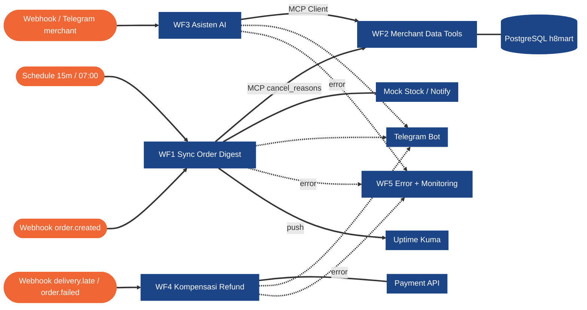

# 02 · Desain Solusi + Solution Fit + ROI · H8Mart Quick-Commerce Ops

**Nama:** Hani Alfiyyah  
**Workflow yang dibangun:** WF1 Stock Sync, Order Intake & Digest, WF2 Merchant Data Tools, WF3 Asisten AI Merchant, WF4 Kompensasi & Refund, WF5 Reliability & Monitoring

## 1. Arsitektur 5 Workflow

## 2. Keputusan Pendekatan per Titik Keputusan (rule-based vs AI-driven)

| Kode | Pertanyaan yang diputuskan                              | Jenis data                                       | Pendekatan           | Alasan                                                                          |
| ---- | ------------------------------------------------------- | ------------------------------------------------ | -------------------- | ------------------------------------------------------------------------------- |
| D1   | Apakah stok cukup untuk order ini?                      | Qty di `core.merchant_stock` vs qty order        | Rule-based           | Ambang objektif; Switch → 200 / `accepted_low_stock` / 409                      |
| D2   | Apakah sync/digest gagal diam-diam atau terlalu lambat? | Jumlah baris sync, durasi run, digest KPI kosong | Rule-based           | Threshold tetap; `Fail Sync 0 Rows` / `Fail Digest Empty` / `Too Slow?` + alert |
| D3   | Berapa voucher / apakah refund butuh approval?          | `minutes_late`, `total_amount`, `payment_status` | Rule-based + manusia | Voucher Rp10k/25k otomatis; refund ≥ Rp100.000 → Ops Telegram                   |
| D4   | Mengapa order merchant banyak batal?                    | Agregat order + tool MCP `cancel_reasons`        | AI + tools           | Pertanyaan bahasa alami; angka harus dari tool/DB, bukan model alone            |
| D5   | Apakah jawaban AI layak dikirim (guardrail)?            | Structured output + confidence / injeksi         | AI + rule + manusia  | Parser + eskalasi ke CS (`ops.tickets`) bila ragu/tidak aman                    |

## 3. Estimasi ROI

Asumsi kurs: **1 USD ≈ Rp16.500** (cek mandiri saat submit; sesuaikan bila perlu). Tarif tenaga Ops/CS: **Rp75.000/jam** (asumsi eksplisit).

| Komponen                                               | Rumus / asumsi                                                                                                                                                                                                                                                                                                                                                                                                                                      | Angka                 |
| ------------------------------------------------------ | --------------------------------------------------------------------------------------------------------------------------------------------------------------------------------------------------------------------------------------------------------------------------------------------------------------------------------------------------------------------------------------------------------------------------------------------------- | --------------------- |
| Waktu manual per hari untuk menyusun laporan Ops       | 45 menit × 22 hari kerja                                                                                                                                                                                                                                                                                                                                                                                                                            | ~16,5 jam/bulan       |
| Waktu CS per pertanyaan merchant (menarik data manual) | 15 menit/kasus × 40 kasus/bulan                                                                                                                                                                                                                                                                                                                                                                                                                     | 10 jam/bulan          |
| Waktu finance/Ops per refund atau voucher manual       | 10 menit × 60 kasus/bulan                                                                                                                                                                                                                                                                                                                                                                                                                           | 10 jam/bulan          |
| Jumlah kasus per bulan                                 | Asumsi dari volume seed + operasi kelas (bukan produksi real)                                                                                                                                                                                                                                                                                                                                                                                       | ~40 Q + 60 kompensasi |
| Biaya tenaga per jam                                   | Asumsi                                                                                                                                                                                                                                                                                                                                                                                                                                              | Rp75.000              |
| Penghematan per bulan                                  | (16,5+10+10) × 75.000                                                                                                                                                                                                                                                                                                                                                                                                                               | **≈ Rp2.737.500**     |
| Biaya LLM per bulan                                    | Diukur dari OpenAI Usage (**last 1d**, 16 Nov 2026): model `gpt-6-luna` · **11** requests · **12.341** input · **2.095** output · spend **$0.0024** (Responses + Chat Completions). Cek harga: 12.341×$0.10/1M + 2.095×$0.50/1M ≈ $0.0023 ≈ $0.0024 ([OpenAI Pricing](https://developers.openai.com/api/docs/pricing)). Skala 22 hari kerja setara → 22×$0.0024 = **$0.0528** (~Rp870); buffer 2× (retry/digest MCP) → **≈ $0.11** (~Rp1.800)/bulan | ~Rp1.800              |
| Biaya platform per bulan                               | Self-hosted VPS (lihat docs/03): ~US$20–25 setara compute+IP+admin amortisasi ringan                                                                                                                                                                                                                                                                                                                                                                | ~Rp350.000            |
| **Net benefit per bulan** dan **payback**              | 2.737.500 − 1.800 − 350.000 ≈ **Rp2.385.700**/bulan. Biaya awal setup ~8 jam × 75.000 = Rp600.000 → payback **&lt; 1 bulan**                                                                                                                                                                                                                                                                                                                        | Payback &lt; 1 bulan  |

Risiko ROI (minimal dua) dan skenario terburuk:

1. Volume pertanyaan/refund nyata jauh lebih kecil → penghematan tenaga turun; VPS tetap jalan.
2. Biaya LLM naik atau prompt membengkak (banyak tool call) → pantau usage; batasi digest MCP ke 1 merchant top.
3. Skenario terburuk: VPS down saat penilaian + secret bocor → nilai Deployment turun; mitigasi backup export + rotate token.

## 4. Batas Automasi & Risiko

| Risiko                                       | Dampak              | Mitigasi di rancangan                                             |
| -------------------------------------------- | ------------------- | ----------------------------------------------------------------- |
| Payment dipanggil dua kali                   | Double payout       | `Idempotency-Key` + `ON CONFLICT` di `ops.compensations` / refund |
| AI mengarang angka cancel                    | Merchant salah info | MCP/SQL mirror; guardrail eskalasi; structured output             |
| Sync 0 baris / digest kosong lolos diam-diam | Ops buta            | Node fail terkendali + WF5 alert; Kuma heartbeat                  |
| Chat asing memakai bot                       | Data merchant bocor | WF3b allowlist `ops.telegram_merchants`                           |
| Schedule spam alert di VPS                   | Noise / ban         | Deactivate Schedule setelah evidence (webhook tetap on)           |
