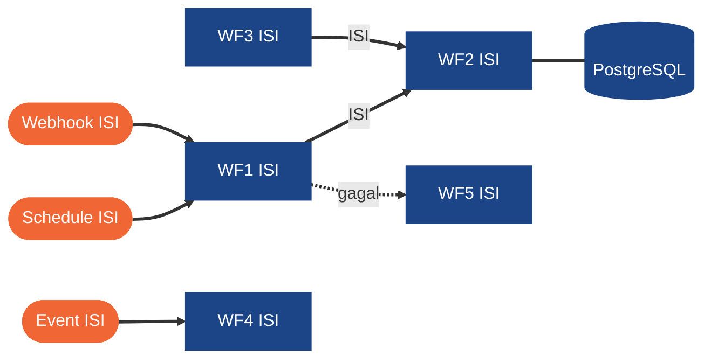

# 02 · Desain Solusi + Solution Fit + ROI · H8Mart Quick-Commerce Ops

**Nama:**
**Workflow yang dibangun:** WF1 Stock Sync, Order Intake & Digest, WF2 Merchant Data Tools, WF3 Asisten AI Merchant, WF4 Kompensasi & Refund, WF5 Reliability & Monitoring

> Template dokumen Milestone (target selesai W3D5 23.59, maksimal W4D4 23.59). Isi langsung berkas ini.
> Tulis alasan, bukan hanya jawaban. Angka harus punya rumus dan asumsi yang bisa ditelusuri.

## 1. Arsitektur 5 Workflow

> Perbaiki diagram di bawah menjadi rancangan kalian (nama workflow, trigger, sistem eksternal, DB). Mermaid dirender GitHub.

## 2. Keputusan Pendekatan per Titik Keputusan (rule-based vs AI-driven)

| Kode | Pertanyaan yang diputuskan | Jenis data | Pendekatan (rule-based / AI / manusia) | Alasan |
| --- | --- | --- | --- | --- |
| D1 | Apakah stok cukup untuk order ini? | | | |
| D2 | Apakah cancel rate atau SLA hari ini melewati ambang? | | | |
| D3 | Berapa voucher atau apakah refund butuh approval? | | | |
| D4 | Mengapa order merchant banyak batal? (pertanyaan merchant) | | | |
| D5 | Apakah jawaban AI layak dikirim ke merchant (guardrail)? | | | |

## 3. Estimasi ROI

| Komponen | Rumus / asumsi | Angka |
| --- | --- | --- |
| Waktu manual per hari untuk menyusun laporan Ops | | |
| Waktu CS per pertanyaan merchant (menarik data manual) | | |
| Waktu finance/Ops per refund atau voucher manual | | |
| Jumlah kasus per bulan (dasar dari data seed atau asumsi eksplisit) | | |
| Biaya tenaga per jam (asumsi) | | |
| Penghematan per bulan | | |
| Biaya LLM per bulan (estimasi token × harga model di halaman resmi penyedia; cantumkan sumber harga. Nilai penuh: token dari eksekusi kalian sendiri) | | |
| Biaya platform per bulan (rujuk dokumen 03) | | |
| **Net benefit per bulan** dan **payback** | | |

Risiko ROI (minimal dua) dan skenario terburuk:

## 4. Batas Automasi & Risiko

| Risiko | Dampak | Mitigasi di rancangan |
| --- | --- | --- |
| | | |
