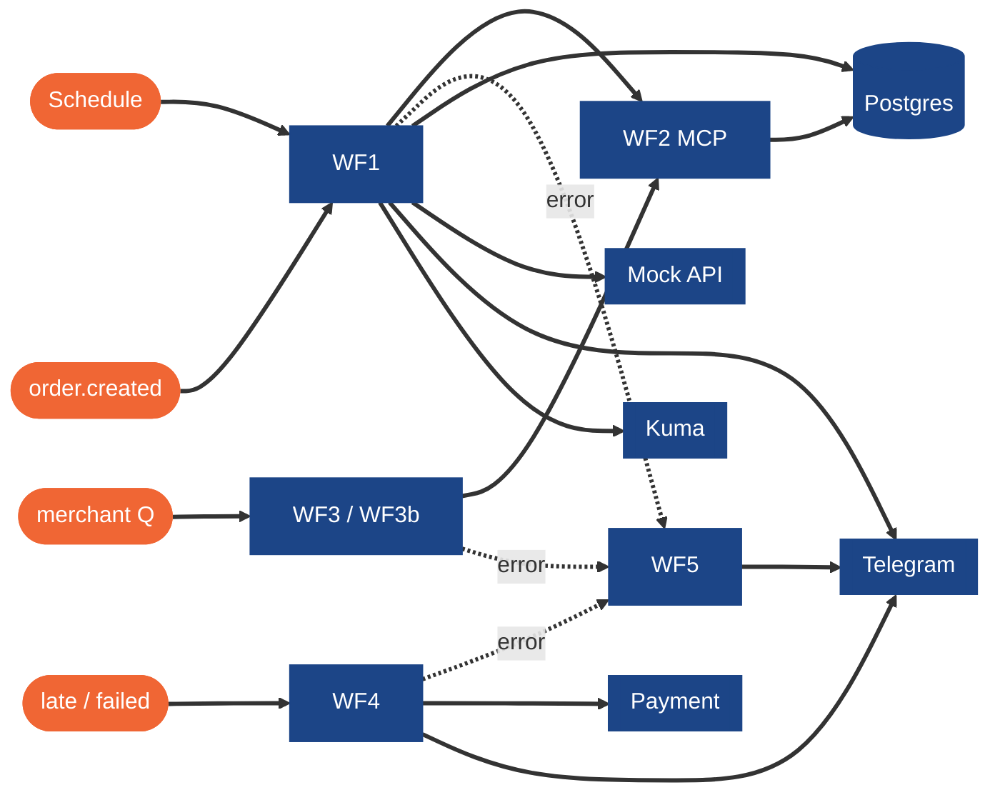

# H8Mart Quick-Commerce Ops · Hani Alfiyyah

## 1. Ringkasan (3 kalimat)

Solusi ini mengotomasi sinkron stok merchant, intake order, digest pagi, kompensasi/refund, dan asisten AI merchant di n8n self-hosted (VPS HTTPS). Lima workflow (+ WF3b Telegram) terhubung ke PostgreSQL H8Mart, mock API, OpenAI `gpt-6-luna`, Telegram Ops, dan Uptime Kuma. Penilai memverifikasi lewat Production URL ber-Header Auth; evidence dan export ada di repo ini.

## 2. Arsitektur



## 3. Daftar Workflow

| Workflow                              | File                                            | Trigger                                                             | Fungsi satu kalimat                                                   |
| ------------------------------------- | ----------------------------------------------- | ------------------------------------------------------------------- | --------------------------------------------------------------------- |
| WF1 Stock Sync, Order Intake & Digest | `workflows/wf1-sinkron-order-digest.json`       | Schedule 15m + 07:00 (disabled di export) · Webhook `order-created` | Sync stok idempotent, terima/tolak order, digest + MCP cancel reasons |
| WF2 Merchant Data Tools               | `workflows/wf2-merchant-data-tools.json`        | MCP Server Trigger                                                  | Tiga tool read-only (`mcp_reader`) untuk agent/digest                 |
| WF3 Asisten AI Merchant               | `workflows/wf3-asisten-ai-merchant.json`        | Webhook `merchant-assistant`                                        | Agent terstruktur + guardrail eskalasi                                |
| WF3b Chat Telegram                    | `workflows/wf3b-telegram-chat-asisten.json`     | Telegram Trigger                                                    | Allowlist chat → panggil WF3 webhook                                  |
| WF4 Kompensasi & Refund               | `workflows/wf4-kompensasi-refund.json`          | Webhook `ops-events`                                                | Voucher otomatis; refund besar butuh approval Telegram                |
| WF5 Reliability & Monitoring          | `workflows/wf5-reliability-error-workflow.json` | Error Trigger                                                       | Alert Telegram (+ Notification) dengan business key                   |

## 4. Cara Menjalankan

### macOS / Linux / Git Bash

```bash
git clone <repo-public-anda>
cd mart-ops   # atau nama folder repo
cp .env.example .env
# edit .env: password DB, WEBHOOK_TOKEN, MOCK_API_KEY, N8N_ENCRYPTION_KEY, dll.

docker compose up -d
docker compose ps
```

VPS (setelah SETUP.md §7: EC2, DuckDNS, `.env` VPS):

```bash
docker compose -f compose.yaml -f compose.vps.yaml up -d
docker compose -f compose.yaml -f compose.vps.yaml ps
```

### PowerShell 7

```powershell
git clone <repo-public-anda>
Set-Location mart-ops
Copy-Item .env.example .env
docker compose up -d
docker compose ps
```

### Import & credential

1. Buka n8n → Import dari `workflows/wf5-…` dulu, lalu WF2, WF1, WF3, WF3b, WF4.
2. Buat credentials: `PG mcp_reader`, `PG ops_writer`, Header Auth webhook (`X-H8Mart-Token`), Header Auth mock (`X-Api-Key`), Telegram, OpenAI.
3. Remap semua `GANTI-ID-*` ke credential nyata.
4. Ganti `ISI_CHAT_ID` (Ops) dan `ISI_TOKEN_PUSH_KUMA` di WF1.
5. Bot: @BotFather → `/start` dari akun Ops → isi allowlist `ops.telegram_merchants` (lihat SETUP §5b).
6. Settings: timezone `Asia/Jakarta`; Error Workflow = WF5 pada WF1–WF4.
7. Publish semua. Jalankan Path A sync sekali (Execute manual) agar stok terisi.
8. Export submission sudah menonaktifkan **Schedule Sync 15m** dan **Schedule Digest 07:00** (`disabled: true`); webhook tetap hidup. Jangan aktifkan lagi kecuali instruktur meminta.

Placeholder di export: `GANTI-ID-PG-READER`, `GANTI-ID-PG-WRITER`, `GANTI-ID-WEBHOOK`, `GANTI-ID-MOCK-API`, `GANTI-ID-TELEGRAM`, `GANTI-ID-OPENAI`, `ISI_CHAT_ID`, `ISI_TOKEN_PUSH_KUMA`.

## 5. Cara Memverifikasi (untuk penilai)

Base URL Production: lihat DM (contoh bentuk `https://h8mart-hani.duckdns.org`). Header: `X-H8Mart-Token: <token-penilaian>`.

| Skenario                                                | Perintah / aksi                                                    | Hasil yang terlihat                          | Bukti                             |
| ------------------------------------------------------- | ------------------------------------------------------------------ | -------------------------------------------- | --------------------------------- |
| Deploy HTTPS + stack hidup                              | Buka domain; `docker compose … ps`; curl luar VPS                  | Padlock; services Up; HTTP 200 webhook       | `evidence/deploy/01`–`03`         |
| Sinkron stok: retry, dead-letter, stok habis terdeteksi | Execute Path A sekali; cek M009                                    | ~205 rows; dead-letter; Kuma Up setelah push | `evidence/wf1/`                   |
| Order ditolak stok habis; event ganda tidak dobel       | `POST /webhook/order-created` fixture ok + stok-habis; kirim ok 2× | 200 / 409; satu baris order                  | `evidence/wf1/`                   |
| Digest harian                                           | Execute Path C sekali (schedule sudah off di export)               | Telegram digest + top cancel reasons         | `evidence/wf1/`                   |
| MCP tool                                                | WF3 tanya batal kemarin; cek Executions WF2                        | Tool `cancel_reasons` terpanggil             | `evidence/wf2/`                   |
| Asisten AI                                              | `POST /webhook/merchant-assistant` + kasus eskalasi/injeksi        | `dijawab` / ticket / fallback                | `evidence/wf3/`                   |
| Voucher/refund vs approval                              | `POST /webhook/ops-events` late + failed besar                     | Voucher issued; approval Telegram → refunded | `evidence/wf4/`                   |
| Retry → dead-letter → alert                             | Fail merchant / Payment fail-next; paksa error                     | Alert business key; WF5 run                  | `evidence/wf5/`                   |
| Heartbeat / silent fail / lambat                        | Sync sukses; uji 0-row / slow                                      | Kuma Up/Down; alert                          | `evidence/wf5/`                   |
| Bot Telegram                                            | Digest, alert, Approve/Decline, chat WF3b                          | Username bot di DM; allowlist                | `evidence/wf3/` · `wf4/` · `wf1/` |

Contoh curl (ganti base URL + token):

```bash
curl -s -i -X POST "https://<DOMAIN>/webhook/order-created" \
  -H "X-H8Mart-Token: <TOKEN>" -H "Content-Type: application/json" \
  -d @fixtures/event-order-created-ok.json
```

PowerShell:

```powershell
Invoke-RestMethod -Method Post -Uri "https://<DOMAIN>/webhook/order-created" `
  -Headers @{ "X-H8Mart-Token" = "<TOKEN>" } `
  -ContentType "application/json" `
  -InFile .\fixtures\event-order-created-ok.json
```

## 6. Keputusan Desain & Batasan

- Path B order **tidak** mengurangi stok di DB pada jalur grading (sesuai guide); stok truth dari sync API.
- Refund approval threshold **Rp100.000**; voucher late **Rp10.000 / Rp25.000** (batas 20 menit) — lihat WF4 `Apply Policy`.
- WF4 baca order memakai `PG mcp_reader`; tulis kompensasi/refund memakai `PG ops_writer`.
- WF3b terpisah agar Telegram Trigger jelas di n8n Workflow Build.
- Kedua Schedule WF1 sudah **Deactivate** di export VPS; webhook tetap Published untuk smoke penilai.
- Kuma Push merah saat schedule off = normal (tidak ada heartbeat), bukan berarti n8n down.
- Uji penolakan `chat_id` asing: ditunda sampai ada akun Telegram kedua.

## 7. Struktur Repo

```text
mart-ops/
├── README.md / SETUP.md / data-contract.md
├── compose.yaml / compose.vps.yaml / Caddyfile
├── .env.example
├── workflows/          # export WF1–WF5 + WF3b (placeholder scrubbed)
├── docs/               # 01–05 dokumen kerangka
├── evidence/           # wf1..wf5 + deploy (screenshot bernomor)
├── fixtures/           # event & dev-set asisten
├── guide/              # syarat tugas
├── seed/               # schema + data + roles
└── mock-api/
```
