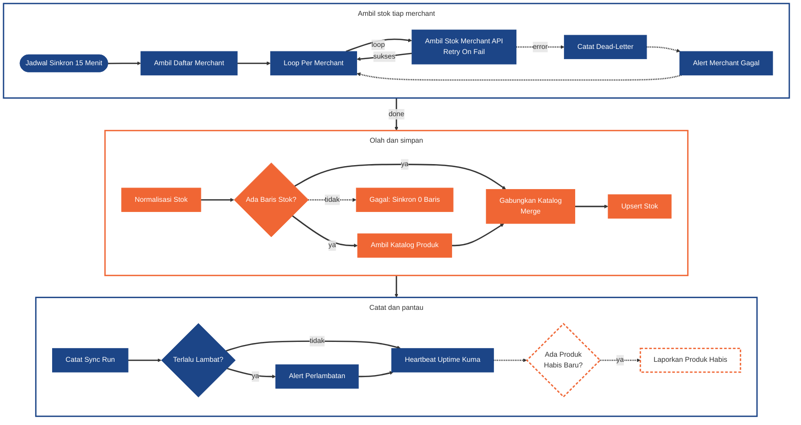
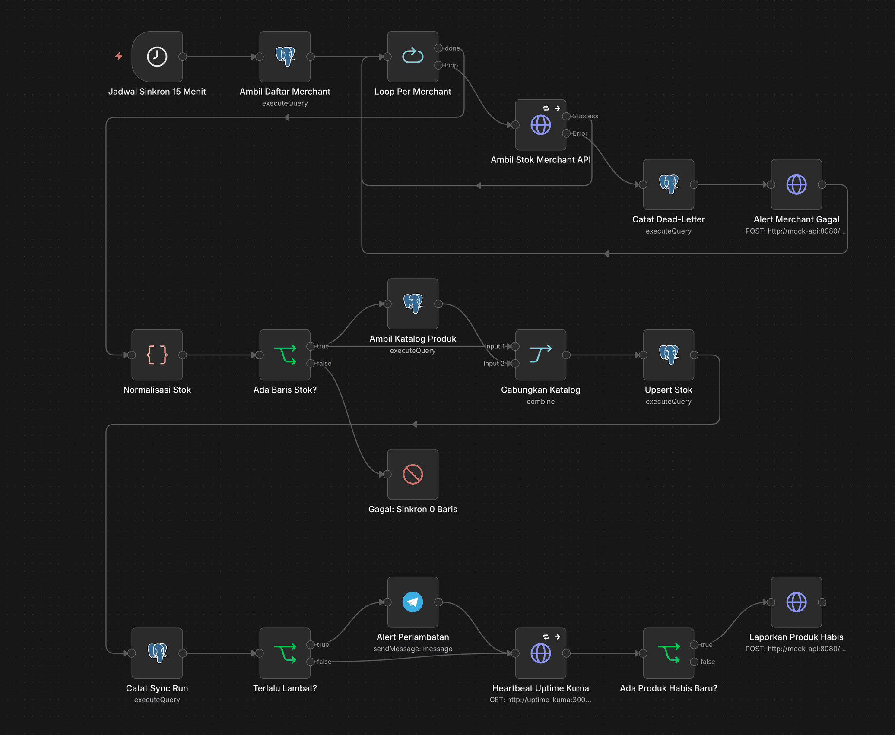
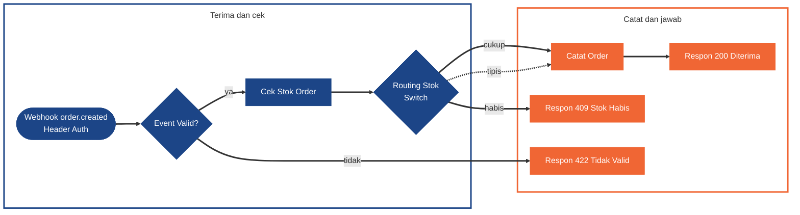
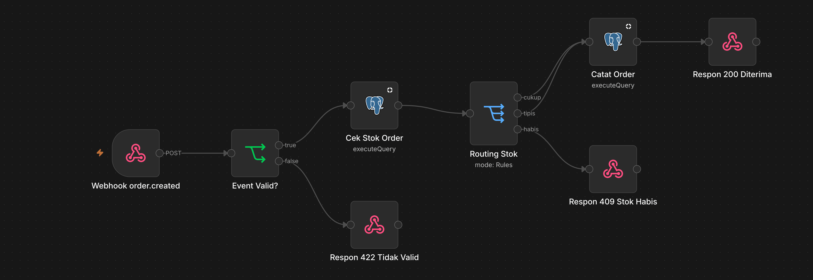
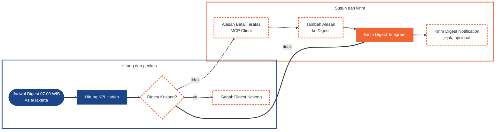
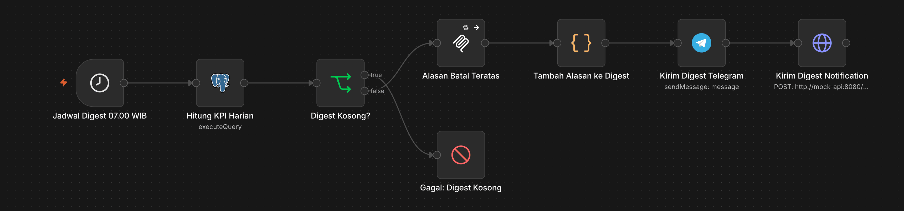

# WF1 · Stock Sync, Order Intake dan Digest Ops

[Guide](README.md) · [Tugas](tasks.md) · cara membaca diagram: [Guide](README.md#cara-membaca-diagram)

WF1 punya **tiga jalur** dengan trigger sendiri-sendiri.

## Syarat

### Minimum (Meet Expectations)

**Jalur A · Sinkron stok**

- **Schedule Trigger tiap 15 menit**.
- Ambil stok tiap merchant dari Merchant Stock API dengan **Retry On Fail**: merchant yang gagal permanen masuk dead-letter, merchant lain tetap diproses.
- Normalisasi (format SKU dan jumlah berbeda dari tabel kita).
- **Merge** dengan katalog produk.
- **Upsert idempotent** ke `core.merchant_stock` (dua kali jalan tidak membuat duplikat).

**Jalur B · Order masuk**

- **Webhook** `order.created` dengan **Header Auth**: cek stok.
- **If/Switch** memutuskan diterima atau ditolak karena stok habis, lalu Respond to Webhook.

**Jalur C · Digest Ops 07.00 WIB**

- Jumlah order, cancel rate, dan SLA 30 menit untuk hari data terakhir, dikirim ke **Telegram** (Send Message, format rapi).
- Salinan ke Notification API boleh sebagai jejak.

### Nilai penuh

- **Jalur A:** deteksi produk yang **baru** menjadi 0 dan laporkan ke tim.
- **Jalur B:** cabang ketiga (diterima dengan peringatan stok tipis); event yang dikirim dua kali tidak membuat order ganda.
- **Jalur C:** alasan batal teratas lewat **MCP Client** ([WF2](wf2-merchant-data-tools.md)); angka digest sama dengan SQL independen atas `core.orders`.

Node pantau di jalur A dan C (`Catat Sync Run`, `Terlalu Lambat?`, `Heartbeat Uptime Kuma`, `Gagal: Sinkron 0 Baris`, `Gagal: Digest Kosong`) adalah bagian pemantauan; rinciannya di [WF5](wf5-reliability-monitoring.md). Minimum cukup **satu** deteksi diam-diam: diagram memakai sinkron 0 baris (jalur A) sebagai contoh, jadi `Digest Kosong?` dan `Gagal: Digest Kosong` di jalur C bergaris putus.

## Diagram

**Jalur A · Sinkron stok tiap 15 menit**

**Jalur B · Order masuk**

**Jalur C · Digest Ops 07.00 WIB**

