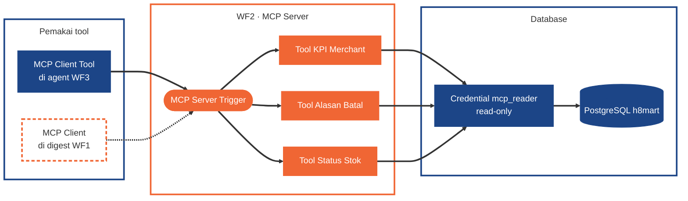
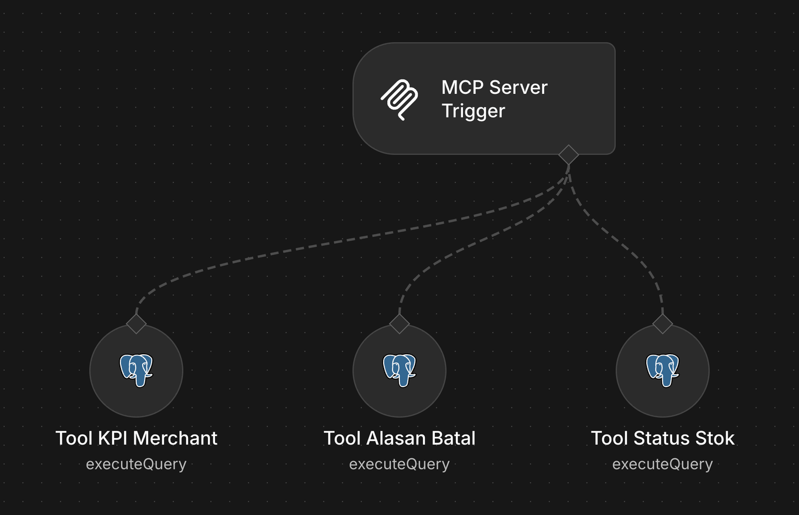

# WF2 · Merchant Data Tools (MCP Server)

[Guide](README.md) · [Tugas](tasks.md) · cara membaca diagram: [Guide](README.md#cara-membaca-diagram)

## Syarat

### Minimum (Meet Expectations)

- **MCP Server Trigger** dengan **tiga tool read-only berparameter** (nama tool bebas):
  - **KPI per merchant** untuk satu tanggal, termasuk **SLA per merchant**.
  - **Alasan batal** per merchant untuk satu tanggal beserta **contoh catatan pelanggan** (teks bebas pelanggan = data tidak tepercaya).
  - **Status stok** per merchant (dan/atau per SKU).
- Credential database memakai role **`mcp_reader`**.
- Tool dipanggil **agent [WF3](wf3-ai-merchant-assistant.md) lewat MCP Client Tool**.

### Nilai penuh

- Tool juga dipakai lewat **MCP Client** (langkah deterministik dengan parameter tetap, mis. di digest [WF1](wf1-stock-sync-order-intake.md)).
- Bukti `INSERT` lewat `mcp_reader` ditolak.

## Diagram

