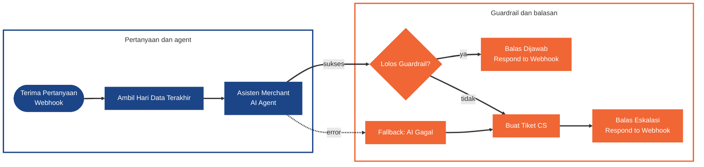
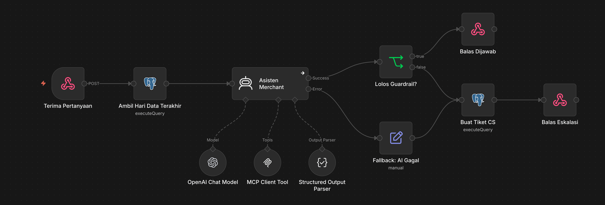
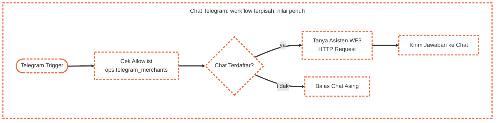
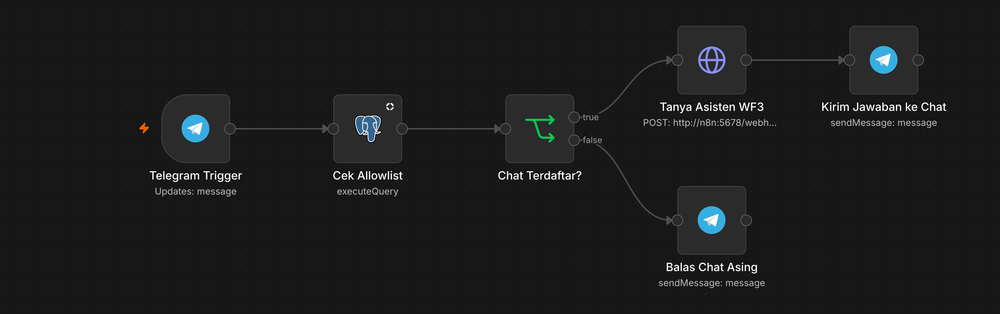

# WF3 · Asisten AI Merchant

[Guide](README.md) · [Tugas](tasks.md) · cara membaca diagram: [Guide](README.md#cara-membaca-diagram)

## Syarat

### Minimum (Meet Expectations)

- **AI Agent** dengan **OpenAI Chat Model `gpt-6-luna`** menjawab pertanyaan merchant dari tool [WF2](wf2-merchant-data-tools.md) (MCP Client Tool). API key OpenAI dibagikan instruktur, dipakai lewat credential n8n (bukan di workflow); Anthropic Claude opsional bila punya key sendiri.
- Output **terstruktur** (Structured Output Parser): `jawaban`, `data_dipakai`, `confidence`, `perlu_eskalasi`.
- **Guardrail:** confidence rendah, data tidak cukup, atau `perlu_eskalasi` berarti pertanyaan diteruskan ke CS (baris di `ops.tickets`), bukan dijawab AI. Agent **tidak menjanjikan kompensasi atau memutuskan refund**; pertanyaan kompensasi dieskalasi ke CS.
- **Fallback:** agent gagal atau output tidak valid tidak menjatuhkan workflow (On Error: `Continue (using error output)`), hasilnya eskalasi ke CS.
- **Webhook production Published dengan Respond to Webhook** (kontrak: [data-contract.md](../data-contract.md) bagian 5).

### Nilai penuh

- Catatan pelanggan dan pertanyaan diperlakukan sebagai **data tidak tepercaya**: agent tidak menjalankan instruksi di dalamnya dan tidak mengambil data merchant lain.
- **Dev set `fixtures/dev-set-asisten.json` dijalankan dan hasilnya dilaporkan** (tabel aktual vs label).
- **Chat asisten lewat Telegram:** Telegram Trigger di instance HTTPS memakai logika yang sama dengan **allowlist `chat_id`** ke `merchant_id` (chat asing ditolak sopan). Boleh workflow terpisah (`wf3b-<nama>.json`). Aturan Telegram: [telegram-bot.md](telegram-bot.md).

## Diagram

Chat asisten lewat Telegram (nilai penuh) boleh dibuat sebagai workflow terpisah yang meneruskan pertanyaan ke Webhook WF3, sehingga logika agent tetap satu:

