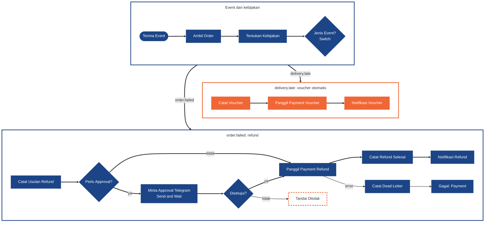
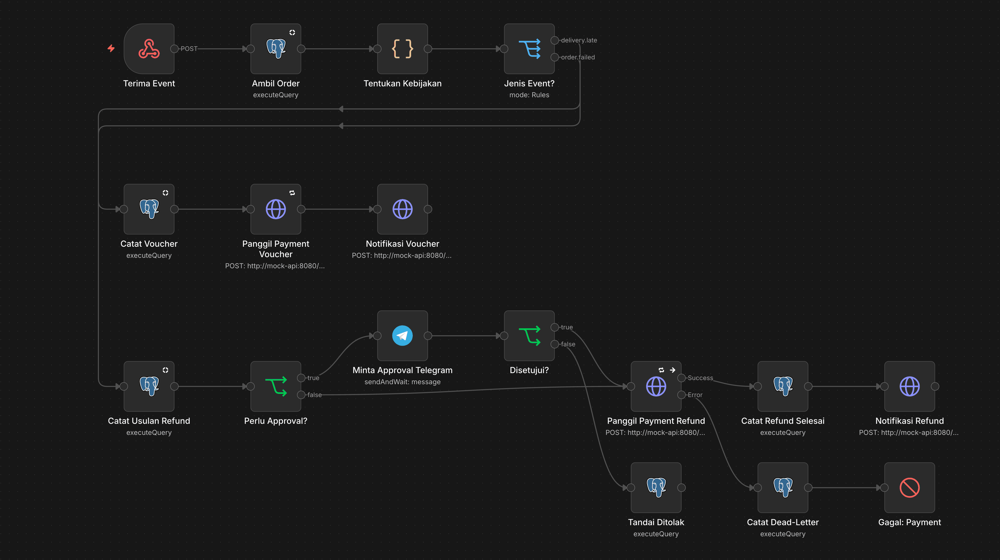

# WF4 · Kompensasi dan Refund

[Guide](README.md) · [Tugas](tasks.md) · cara membaca diagram: [Guide](README.md#cara-membaca-diagram)

## Syarat

### Minimum (Meet Expectations)

- Webhook menerima `delivery.late` dan `order.failed`.
- **Kebijakan rule-based yang kalian tetapkan dan dokumentasikan**, dengan ambang dan nominal ditulis eksplisit:
  - voucher keterlambatan **otomatis** sampai ambang tertentu;
  - refund di atas ambang **butuh approval Ops**.
- **Approval lewat bot Telegram:** node **Send and Wait for Response** (Approval, tombol Approve dan Decline) mengirim pesan ke chat Ops kalian.
  - Tombolnya baru bisa dipakai setelah VPS HTTPS hidup ([telegram-bot.md](telegram-bot.md)).
  - Selama lokal, uji jalur ini dengan **Wait node** (resume URL dibuka di browser laptop). Wait node dengan resume URL atau form tetap boleh sebagai alternatif bila tombol Telegram tidak dipakai.
- Keputusan tercatat di `ops.refund_actions`.
- Panggilan ke **Payment API dengan `Idempotency-Key`**, lalu **Notification API**, lalu catat di `ops.compensations` dan `ops.refund_actions`.
- Kegagalan Payment yang tidak pulih masuk dead-letter.

### Nilai penuh

- Voucher dan refund **hanya sekali** walau event atau approval terkirim dua kali.
- Ops bisa menolak (tercatat, Payment tidak dipanggil).
- Nominal refund = `core.orders.total_amount`.
- Retry Payment terbukti.

## Diagram

