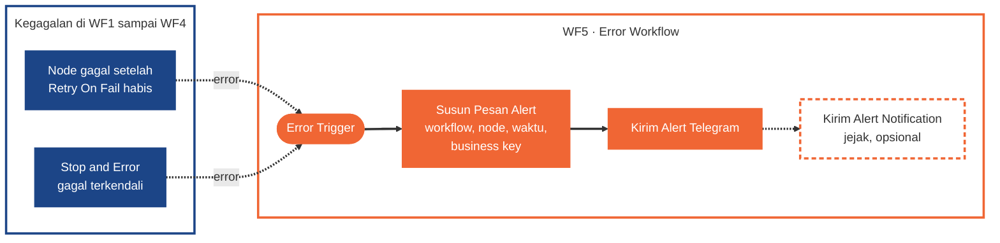
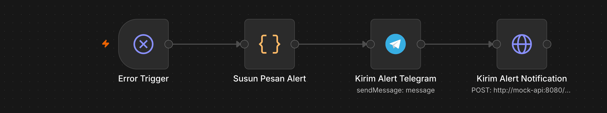

# WF5 · Reliability dan Monitoring

[Guide](README.md) · [Tugas](tasks.md) · cara membaca diagram: [Guide](README.md#cara-membaca-diagram)

## Syarat

### Minimum (Meet Expectations)

- **Error Workflow pusat** (Error Trigger) dipasang di WF1-WF4 (Settings › Error Workflow) dan mengirim alert ke **Telegram** berisi workflow, node, waktu, dan business key.
- Mekanisme lain dipasang di workflow sumbernya dan berakhir di alert yang sama:
  - **dead-letter** di `ops.dead_letter` ([WF1](wf1-stock-sync-order-intake.md) jalur A, [WF4](wf4-compensation-refund.md));
  - **heartbeat Uptime Kuma** untuk sinkron stok, Up dan Down (WF1 jalur A; cara membuat monitor Push: [data-contract.md bagian 7](../data-contract.md#7-uptime-kuma));
  - **satu** deteksi kegagalan diam-diam: sinkron 0 baris (WF1 jalur A) atau digest kosong (WF1 jalur C) yang tidak boleh lolos sebagai sukses;
  - **satu** alert ambang durasi sinkron (WF1 jalur A; boleh dengan ambang yang kalian turunkan sementara).
- Digest pagi dan alert dikirim ke Telegram.

### Nilai penuh

- Kedua deteksi diam-diam (0 baris **dan** digest kosong).

## Bukti empat mekanisme error handling

Keempatnya termasuk **Minimum**, masing-masing dengan **bukti eksekusi atau baris data**:

| Mekanisme | Bukti minimum | Folder |
| --- | --- | --- |
| Retry on fail | panggilan Merchant Stock API gagal lalu berhasil pada percobaan berikutnya: Executions + jumlah panggilan (`GET /admin/stock-calls`) | `evidence/wf1/` |
| Dead-letter handling | baris di `ops.dead_letter` untuk kegagalan yang tidak pulih (mis. merchant M009 yang selalu gagal dan order `HM-SP-099` saat Payment down) berisi `workflow`, `node`, `execution_id`, `business_key`, `error_message`, `payload`, `attempts` | `evidence/wf5/` |
| Alerting | pesan alert **di Telegram** (Send Message) berisi workflow, node, waktu, dan **business key** (`order_id` atau `merchant_id`); screenshot chat di HP + Executions | `evidence/wf5/` |
| Error trigger workflow | satu Error Workflow pusat (Error Trigger) yang dipasang di WF1-WF4 dan terbukti tereksekusi | `evidence/wf5/` |

Bukti monitoring (heartbeat Kuma Up dan Down, deteksi diam-diam, alert perlambatan) masuk ke `evidence/wf5/`.

## Diagram

